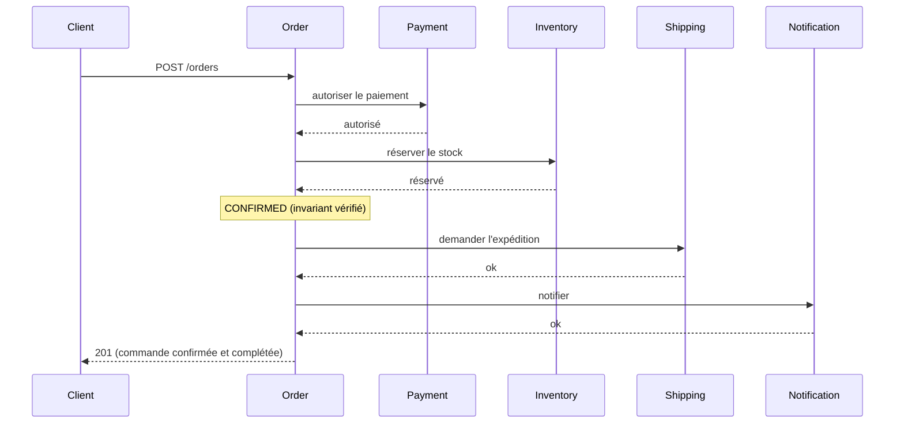
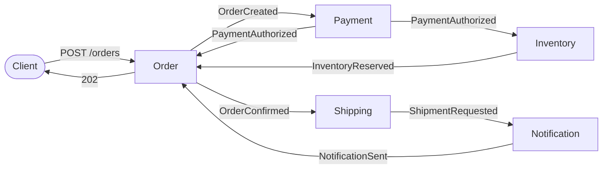
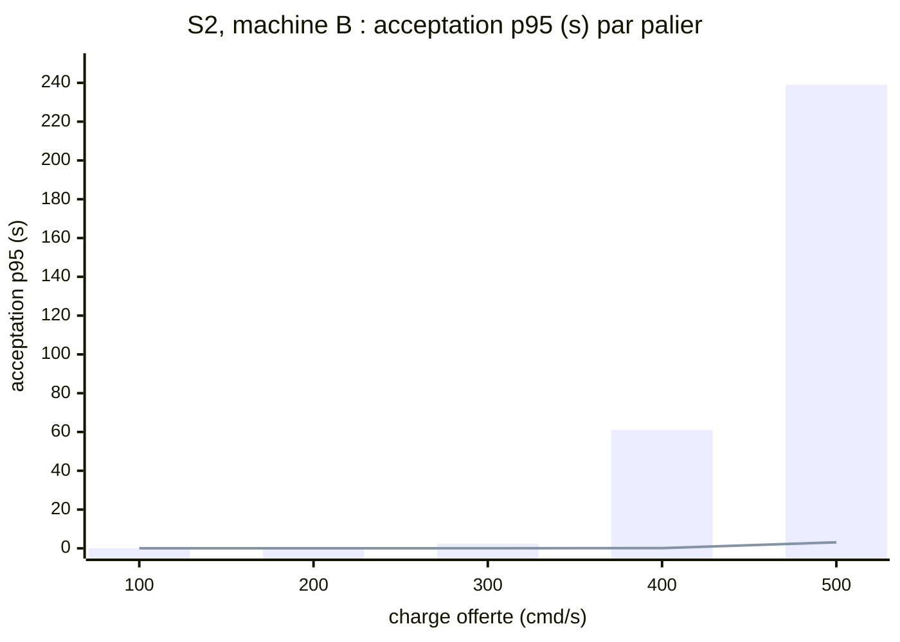
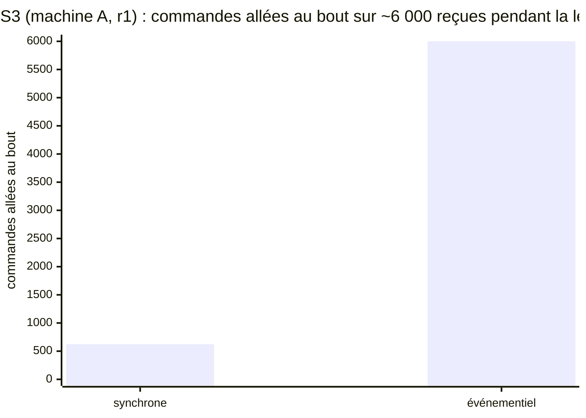
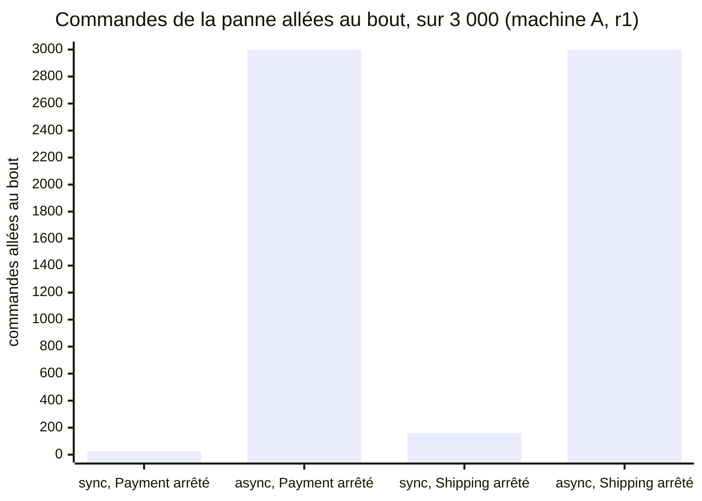
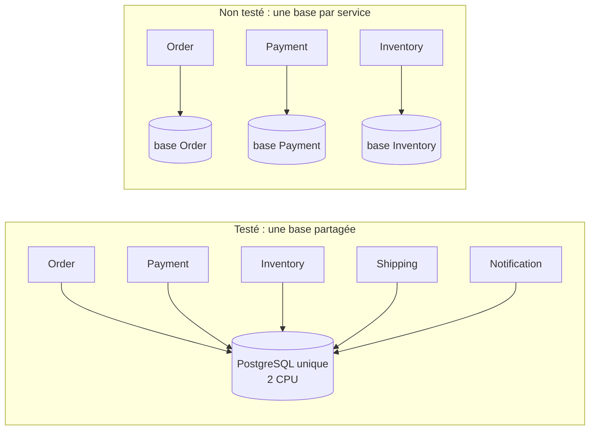
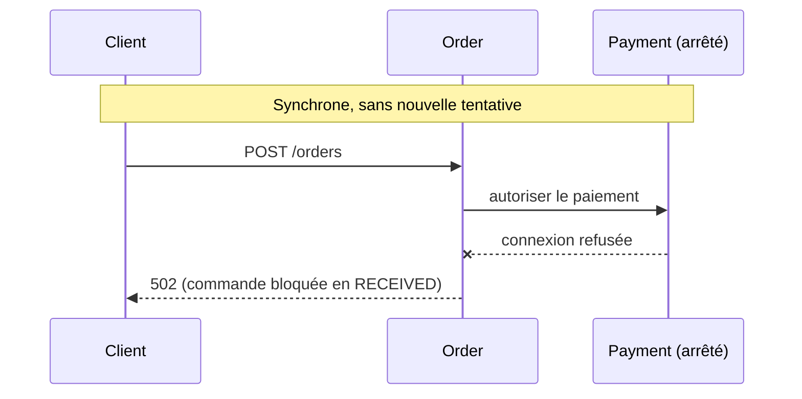
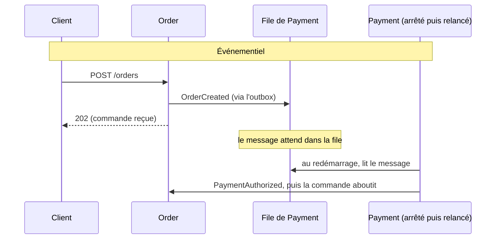

# ADR-001 — Communication architecture for order processing

| | |
|---|---|
| **Status** | **Accepted** — 2026-11-09 ;
| **Décision** | **ADOPT SYNCHRONOUS** |
| **Auteurs** | Régis ATEMENGUE & Louis Félix St-Amour|
| **Preuves** | `results/` (un dossier par run), code dans `sync/`, `async/`, `common/` |

Ce document résume le travail effectué pour la création de ce POC : il décrit le raisonnement de départ, ce qui a été construit, comment les mesures ont été faites, ce qu'elles montrent, comment elles ont été interprétées, et la décision qui en découle. Chaque chiffre cite le dossier de `results/` du projet GIT du pr qui le prouve. 

---

## Résumé

**Question.** Les cinq services du traitement des commandes (Order, Payment, Inventory, Shipping, Notification) doivent-ils communiquer de façon **synchrone** (appels REST en chaîne) ou **par événements** (broker de messages) ? La direction technique refuse d'adopter l'événementiel « parce qu'il est plus scalable » sans preuve.

**Démarche.** Les deux architectures ont été implémentées avec la même logique métier, les mêmes ressources et le même invariant, puis soumises aux mêmes six scénarios de charge et de panne, en répétant les mesures sur deux machines. Les hypothèses et leurs seuils ont été fixés avant toute mesure.

**Ce que disent les mesures.**

| Hypothèse | Verdict |
|---|---|
| Les deux tiennent la charge normale (100 cmd/s, p95 < 1 s) | **Oui** (55 à 77 ms) |
| H1 — L'événementiel tient mieux le pic (500 cmd/s) | **Rejetée** : il reçoit tout, mais accepte les commandes 4 à 6 min plus tard ; le synchrone reste conforme plus longtemps (300–400 cmd/s contre 200) |
| H2 — Le synchrone complète nettement plus vite en charge normale | **Rejetée** : écart de 7 à 19 %, sous le seuil de 20 % |
| H3a, H3b, H3c — L'événementiel résiste mieux aux pannes et lenteurs des dépendances | **Supportées** : aucune commande abandonnée en événementiel, des milliers en synchrone |
| H4 — L'idempotence protège l'invariant à faible coût | **Supportée** : 0 effet en double, surcoût négligeable |
| H5 — Une commande est plus difficile à tracer en événementiel | **Rejetée** : 100 % de traces complètes des deux côtés |

L'invariant métier (aucune commande confirmée sans paiement autorisé et stock réservé) n'a **jamais** été violé, dans aucune variante, même en saturation.

**Décision.** **ADOPT SYNCHRONOUS**, complété par un système de nouvelles tentatives à mettre en place et à mesurer. L'argument principal de l'événementiel, la tenue au pic, n'est pas démontré sur ce banc d'essai ; son avantage réel, la résilience aux pannes de dépendances, est reconnu et sera traité dans le synchrone par ce système de nouvelles tentatives.

**Limites principales.** Un seul hôte par campagne (générateur de charge compris) ; une base PostgreSQL partagée par les cinq services, qui pénalise l'événementiel ; aucune nouvelle tentative dans les deux variantes, ce qui pénalise le synchrone en résilience ; H1 repose sur un seul run événementiel valide au pic.

---

## 1. Context

### 1.1 Le système

Une plateforme de commerce électronique traite les commandes avec cinq services :

| Service | Rôle |
|---|---|
| **Order** | Reçoit la commande, en garde l'état, décide de la confirmer ou de la rejeter |
| **Payment** | Autorise (ou refuse) le paiement ; l'annule si la commande est rejetée après autorisation |
| **Inventory** | Réserve le stock |
| **Shipping** | Demande l'expédition |
| **Notification** | Informe le client |

Une commande passe par les états `RECEIVED` → `ACCEPTED` (paiement autorisé) → `CONFIRMED` (stock réservé), ou `REJECTED` (paiement refusé ou stock insuffisant). Elle est **complétée** quand l'expédition et la notification sont faites.

### 1.2 Les contraintes

| Contrainte | Valeur |
|---|---|
| Charge normale | 100 commandes par seconde, sans accumulation de travail |
| Pic promotionnel | 500 commandes par seconde pendant 5 minutes, sans effondrement incontrôlé |
| Latence | p95 < 1 s jusqu'à l'acceptation de la commande (paiement passé), en charge normale |
| Fiabilité | Aucune commande confirmée si le paiement ou la réservation du stock a échoué |
| Observabilité | Pouvoir reconstruire le traitement d'une commande individuelle |

**Invariant non négociable (I1)** : une commande ne peut être confirmée que si le paiement est autorisé **et** le stock réservé. Si le stock est insuffisant après un paiement autorisé, le paiement doit être annulé (compensation).

### 1.3 Le problème

La direction technique ne veut pas adopter une architecture événementielle « parce qu'elle est plus scalable » : elle demande des preuves.

- **Problème** : tenir des pics de charge et des dépendances défaillantes sans jamais violer l'invariant.
- **Incertitude** : nous ne savions pas si le découplage par événements améliore suffisamment la tenue au pic et la tolérance aux pannes de dépendances pour compenser la complexité qu'il ajoute pour préserver l'invariant (idempotence, outbox, cohérence à terme).
- **Assumption centrale** : nous supposions que l'événementiel est plus scalable : sous un pic, la file absorbe la charge et les commandes continuent d'être acceptées dans les délais. C'est cette croyance que le PoC expose à la réfutation (H1).

---

## 2. Architectural drivers

| Driver | Ce qui compte ici | Mesuré par |
|---|---|---|
| Scalability | Tenir 500 cmd/s sans effondrement incontrôlé | S2, H1 |
| Availability | Continuer à prendre en compte les commandes quand une dépendance est lente ou indisponible, et les mener à terme | S3, S4, S4b, H3 |
| Performance | p95 < 1 s jusqu'à l'acceptation en charge normale | S1, exigence S1, H2 |
| Consistency | Invariant tenu, y compris quand un message ou une requête est traité plusieurs fois | Tous, I1 à I11, S5, H4 |
| Observability | Reconstruire le traitement d'une commande individuelle | S1, H5 |
| Operational complexity | Coût de construction, d'exploitation et de compréhension | Inventaire des mécanismes, ressources consommées |

---

## 3. Options considered

### Option 1 — Synchronous workflow (implémentée : `sync/`)

Order orchestre la chaîne en appelant chaque service en REST et en attendant sa réponse.



Stock insuffisant après paiement : Order rejette la commande et demande à Payment d'annuler le paiement.

### Option 2 — Event-driven workflow (implémentée : `async/`)

Order enregistre la commande et publie un événement ; chaque service réagit aux événements qui le concernent (chorégraphie, RabbitMQ). Le client reçoit `202` dès l'enregistrement.



Chemins de rejet : `PaymentDeclined` → Order rejette ; `InventoryInsufficient` → Order rejette et publie `OrderRejected` → Payment annule le paiement (`PaymentVoided`) et Notification informe le client.

### Option 3 — Hybrid (non implémentée, non mesurée)

Cette option n'a pas été construite ; elle n'est citée que comme piste de réévaluation.

### Ce qui est identique entre les options 1 et 2

Seul le style de communication diffère (§5.3) : même logique métier, mêmes ressources, même invariant appliqué par la même requête SQL, même charge, même budget de nouvelles tentatives (zéro).

---

## 4. Hypotheses and success measures

Chaque hypothèse précise le scénario, la mesure et le seuil. **Les seuils ont été fixés avant toute mesure et n'ont pas été modifiés après.** A désigne le synchrone, B l'événementiel.

### 4.1 Définitions des latences

Les latences sont calculées **dans la base**, avec les mêmes requêtes SQL pour A et B, à partir des horodatages de chaque commande :

- **acceptation** = `accepted_at − received_at` (paiement passé) ;
- **confirmation** = `confirmed_at − received_at` (stock réservé, invariant satisfait) ;
- **complétion** = `completed_at − received_at` (expédition et notification faites).

`received_at` est noté à l'arrivée de la requête HTTP, avant tout traitement. On ne compare jamais l'acceptation d'une variante à la complétion de l'autre. La réponse HTTP mesurée par le générateur de charge est rapportée à part : en B, elle ne dit rien du traitement (le `202` arrive avant).

### 4.2 Hypothèses

| # | Attribut | Hypothèse | Scénario | Supportée si | Rejetée si |
|---|---|---|---|---|---|
| **Exigence S1** | Performance | Chaque variante tient la charge normale | S1 | Acceptation p95 < 1 s et drainage nul après la charge (verdict séparé pour A et B) | Sinon |
| **H1** | Scalabilité | Au pic, l'événementiel garde son débit et sa latence d'acceptation | S2 | Au palier à 500 cmd/s, B : débit accepté ≥ 95 % du débit offert **et** acceptation p95 < 1 s **et** 0 violation de I1 ; A manque au moins un de ces seuils | B manque un seuil sans faire mieux que A, ou A tient aussi les trois |
| **H2** | Performance | En charge normale, le synchrone complète plus vite | S1 | Complétion p95 de A au moins 20 % plus faible que celle de B, et acceptation p95 de A < 1 s | Écart < 20 % ou en faveur de B |
| **H3a** | Disponibilité | Un service secondaire en panne n'empêche pas l'événementiel de terminer les commandes | S4b | B : ≥ 99 % des commandes reçues pendant la panne terminées moins de 2 min après le retour de Shipping | B < 99 %, ou plus de 2 min |
| **H3b** | Disponibilité | Payment en panne : l'événementiel ne perd rien et rattrape | S4 | B : 0 commande perdue et ≥ 99 % des commandes de la panne dans un état final moins de 2 min après le retour de Payment | Au moins une perdue, < 99 %, ou plus de 2 min |
| **H3c** | Disponibilité | Payment lent : en événementiel, le client n'attend pas | S3 | B : réponse HTTP p95 < 200 ms et 0 abandon ; A : plus de 50 % d'abandons au délai client de 5 s | B ≥ 200 ms ou avec abandons, ou A ≤ 50 % |
| **H4** | Cohérence | L'idempotence tient l'invariant à faible coût | S5 | Avec protection : 0 effet en double, 0 violation de I1, surcoût de complétion < 10 % ; le témoin sans protection doit montrer des doublons | Effet en double ou violation de I1 avec protection, ou surcoût ≥ 10 % |
| **H5** | Observabilité | Une commande est plus difficile à reconstruire en événementiel | S1 | B < 99 % de traces complètes et A ≥ 99 % | B ≥ 99 % |

H6 (l'hybride cumule les avantages des deux) a été envisagée mais n'a pas été formulée ni mesurée.

### 4.3 Règles de verdict

- **Deux répétitions concordantes** par scénario et par variante pour un verdict définitif ; une seule répétition exploitable donne un verdict **provisoire** ; des répétitions contradictoires donnent « non concluante ».
- Une **mesure manquante** donne « non concluante », jamais un succès implicite.
- Une **violation d'invariant** est un résultat à rapporter, pas un run à jeter.
- Un refus de paiement ou un stock insuffisant voulus (mélange de charge) sont des issues métier (`REJECTED`), pas des erreurs techniques.
- Une métrique de **verdict** décide ; une métrique de **diagnostic** (CPU, profondeur de file, drainage) explique un verdict, elle ne décide rien.

### 4.4 Correspondance prévue avec la décision (fixée avant les mesures)

| Si les mesures montrent… | Décision |
|---|---|
| H1 et H3 supportées, coût (H4, H5) acceptable | ADOPT EVENT-DRIVEN |
| H1 rejetée mais H3 supportée | ADOPT HYBRID ARCHITECTURE (à étayer par une mesure de l'hybride) |
| Ni H1 ni H3 ne départagent, ou le coût l'emporte | ADOPT SYNCHRONOUS |
| Runs invalides, mesures manquantes, répétitions contradictoires | NO DECISION — additional evidence required |

Les mesures donnent la deuxième ligne. L'hybride n'ayant pas été mesuré, l'équipe a retenu le synchrone, complété par des nouvelles tentatives pour traiter sa faiblesse en résilience (§10).

---

## 5. Evidence collected : ce qui a été construit et comment on a mesuré

### 5.1 Démarche

1. Le problème, l'incertitude, les hypothèses, leurs seuils et la décision candidate ont été écrits **avant** toute mesure.
2. Les deux variantes ont été construites par étapes, chacune vérifiée sur la pile réelle avant de passer à la suivante : socle (base, observabilité), variante synchrone, vérification des invariants, variante événementielle, contrôle de parité, traces, puis crochets de test et scénarios.
3. Des **essais à blanc** ont servi à éprouver le banc d'essai et à en corriger les défauts (§5.6). Ils ne sont jamais cités comme résultats.
4. Les scénarios ont été exécutés selon un protocole fixe (§5.5), répétés, puis interprétés selon les règles fixées d'avance.

### 5.2 Implémentation

**Pile commune** : Node.js 22 (Fastify), PostgreSQL 17 (SQL explicite), OpenTelemetry → Jaeger (traces), Prometheus et Grafana (métriques), k6 (charge), Docker Compose. Toutes les images sont figées (version et empreinte).

**Variante synchrone (`sync/`)** :
- Order orchestre la chaîne par des appels HTTP (64 connexions sortantes par service cible, délai de 5 s par appel).
- `POST /orders` répond `201` une fois la chaîne terminée, ou `502` si une dépendance échoue.
- Aucune nouvelle tentative : un appel qui échoue laisse la commande dans son état courant.
- Pour S5 : en-tête `Idempotency-Key` ; Order mémorise la réponse et la rejoue si la même requête revient.

**Variante événementielle (`async/`)** :
- **RabbitMQ** : un échange `topic`, une file durable par service consommateur, une file de rejet (DLQ) par service ; messages persistants, confirmations de publication, acquittement après le commit.
- **Outbox transactionnel** : un service écrit l'effet métier et les événements à publier **dans la même transaction**, puis les publie juste après le commit ; un balayage de secours, chaque seconde, republie ce qui serait resté en attente. Aucun événement n'est perdu si le service s'arrête entre le commit et la publication.
- **Consommateurs idempotents** : chaque événement traité est inscrit dans `processed_events` dans la même transaction que son effet ; un événement reçu deux fois est reconnu et ignoré.
- **Ordre d'arrivée chez Order** : les événements de paiement et de stock peuvent arriver dans n'importe quel ordre. Chaque événement note son fait, puis Order tente la décision ; le second arrivé décide.
- **Concurrence** : 64 messages en cours par consommateur, égale aux 64 connexions sortantes du synchrone.
- **Traces** : le contexte de trace voyage dans l'outbox puis dans les en-têtes des messages ; une commande donne une seule trace à travers les cinq services.
- `POST /orders` répond `202` après l'enregistrement de la commande.

**Zone de test, dans les deux variantes** : injection de lenteur sur Payment (`POST /admin/chaos`), arrêt et redémarrage d'un service, livraison des événements en double (événementiel) ou renvoi des requêtes (synchrone), idempotence activable ou non (témoin), taux d'échantillonnage des traces, métriques de requêtes en vol, d'appels en attente de connexion et de doublons écartés.

**Outillage commun (`common/`)** : schéma et données, remise à zéro de la base et des files, vérification des invariants I1 à I11, contrôle de parité, profils k6, script d'exécution d'un scénario (`run-scenario.js`), calcul des latences en base, mesure des traces complètes, et une interface en ligne de commande (`./poc`) qui pilote le tout.

### 5.3 Règles d'équité

La comparaison n'a de sens que si **seul le style de communication diffère** :

| Règle | Mise en œuvre |
|---|---|
| Même logique métier | Les fichiers `domain.js` des cinq services sont identiques dans les deux variantes ; leur empreinte est comparée automatiquement avant chaque run (`./poc parity`) |
| Même invariant | Appliqué en un seul point, par la même requête SQL |
| Mêmes ressources | 1 CPU et 512 Mo par service ; PostgreSQL 2 CPU et 1 Go ; pool de 20 connexions à la base par service (RabbitMQ, 2 CPU et 1 Go, n'existe qu'en événementiel) |
| Même concurrence | 64 traitements en parallèle par service |
| Même budget de nouvelles tentatives | **0** dans les deux variantes ; aucune résilience ajoutée à une seule |
| Même charge | Même profil k6, même mélange (3 % de paiements refusés, 2 % de commandes sur un produit à stock limité), même délai client de 5 s |
| Mêmes latences simulées | Identiques dans les deux variantes |
| Même mesure | Latences calculées en base par les mêmes requêtes ; même taux d'échantillonnage des traces |

### 5.4 Invariants vérifiés après chaque run

| # | Règle | Famille |
|---|---|---|
| **I1** | Une commande confirmée a un paiement autorisé et un stock réservé | Sûreté |
| I2 | Une commande confirmée a exactement un paiement autorisé, du bon montant | Sûreté |
| I3 | Une commande confirmée a exactement une réservation par article, de la bonne quantité | Sûreté |
| I4 | Une commande rejetée pour stock insuffisant n'a plus de paiement autorisé (compensation faite) | Sûreté |
| I5 | Une commande rejetée pour paiement refusé n'a ni réservation ni expédition | Sûreté |
| I6 | Le stock est conservé (initial − réservations = actuel, jamais négatif) | Sûreté |
| I7 | Aucun effet de bord en double (paiement, réservation, expédition, notification) | Sûreté |
| I8 | Une expédition n'existe que pour une commande confirmée | Sûreté |
| I9 | Horodatages cohérents (`received_at ≤ accepted_at ≤ confirmed_at ≤ completed_at`) | Sûreté |
| I10 | Après drainage, aucune commande ne reste `RECEIVED` ou `ACCEPTED` | Vivacité |
| I11 | Toute commande confirmée finit complétée (expédiée et notifiée) | Vivacité |

Une commande bloquée viole la vivacité (I10, I11), pas la sûreté : elle n'est pas confirmée à tort. Les deux familles sont rapportées séparément.

### 5.5 Protocole de mesure

**Scénarios.**

| ID | Charge | Action | Fenêtre du verdict | Hypothèses |
|---|---|---|---|---|
| **S1** | 100 cmd/s pendant 3 min | aucune | les 3 min | Exigence S1, H2, H5 |
| **S2** | Paliers de 1 min à 100, 200, 300, 400 cmd/s, puis 5 min à 500 cmd/s | aucune | le palier à 500 cmd/s | H1 |
| **S3** | 100 cmd/s pendant 3 min, avec une lecture `GET /orders/:id` par seconde | Payment répond en 2 s pendant 60 s | les 60 s de lenteur | H3c |
| **S4** | 100 cmd/s pendant 3 min | Payment arrêté 30 s, puis redémarré | les 30 s de panne | H3b |
| **S4b** | 100 cmd/s pendant 3 min | Shipping arrêté 30 s, puis redémarré | les 30 s de panne | H3a |
| **S5** | 10 cmd/s pendant 1 min | Événementiel : chaque événement livré deux fois. Synchrone : chaque requête renvoyée avec le même `Idempotency-Key`. Trois runs : avec protection, référence sans doublons, témoin sans protection | la minute mesurée | H4 |

Tous les scénarios commencent par un **préchauffage non compté** d'une minute (50 cmd/s ; 10 cmd/s pour S5) : les premières secondes après un démarrage sont plusieurs fois plus lentes (connexions froides).

**Déroulé d'un run** (`./poc scenario <s> --project <sync|async> --rep <n>`) :

1. Contrôles : un seul projet actif, observabilité vivante, parité respectée.
2. Réglages : traces à 10 % pendant S1 à S4 (100 % en S5), idempotence, doublons.
3. Remise à zéro de la base et des files.
4. Charge k6 en modèle ouvert (le débit est imposé, quelle que soit la vitesse du système) ; la phase du scénario est écrite dans chaque commande.
5. Panne posée et levée au moment prévu ; l'heure réelle est contrôlée (écart de plus de 5 s ⇒ run invalide).
6. **Drainage** : attente que toutes les commandes soient terminées, plafonnée à 10 min.
7. Vérification des invariants, latences par phase, métriques, ressources des conteneurs (k6 compris), traces (S1).
8. Classement de validité et écriture de `results/<projet>/<scénario>/rep-<n>/`.

**Délai client de 5 s.** k6 abandonne toute requête sans réponse au bout de 5 s et la compte comme un abandon. Un vrai client abandonne aussi ; sans ce délai, au-delà de la saturation, le générateur aurait besoin de plus de 5 000 requêtes en vol et fausserait le run. Une requête abandonnée continue d'être traitée par le serveur : le verdict est lu en base, pas dans k6. k6 prépare d'avance débit × délai × 1,2 utilisateurs virtuels (3 000 pour S2).

**Validité d'un run.**

| Statut | Condition | Usage |
|---|---|---|
| Valide | Moins de 1 % d'itérations perdues par k6 | Tout verdict |
| Valide sous saturation | ≥ 1 % perdues, mais c'est le système qui sature (utilisateurs virtuels tous occupés, abandons ≥ 1 %) et k6 est en bonne santé (mémoire < 80 %, CPU < 400 %, préchauffage sain) | Seulement pour **rejeter** une hypothèse : un système qui échoue avec moins de charge que prévu échouerait aussi avec toute la charge |
| Invalide | Sinon, ou panne posée hors délai | À refaire ; chiffres indicatifs au mieux |

Le critère « CPU de k6 < 400 % » a été ajouté après un run où k6 avait consommé toute la machine ; il est appliqué à la lecture des runs, pas encore par le script.

**Répétitions et machines.**

| Série | Machine | Scénarios | Ordre |
|---|---|---|---|
| Répétition 1 (2026-11-08) | A | Tous | Synchrone puis événementiel |
| Répétition 2 (2026-11-09) | A | Tous | Événementiel puis synchrone |
| Répétition 3 (2026-11-15) | A, environnement contrôlé | S1, S2 | Synchrone puis événementiel |
| Répétitions 3 et 4 (2026-11-15 et 16) | B | Tous | Synchrone puis événementiel |

- Pendant la répétition 2 de S1 et S2, la machine A était ralentie (tous les conteneurs plus gourmands en CPU pour le même travail, pics ponctuels, base et générateur hors de cause). Ces runs restent valides, mais l'équipe les a déclarés **non concluants pour H1, H2 et l'exigence S1**, et a fait une répétition 3 dans un environnement contrôlé : machine sur secteur, sans économie d'énergie, applications lourdes fermées, pas de mise en veille, observabilité redémarrée, contrôle de santé vert, préchauffage sain.
- La **machine B** est une seconde machine, plus dotée en mémoire (environ 31 Go pour Docker contre 7,7 Go sur la machine A ; caractéristiques CPU non relevées). Toute la pile y tourne. Ses runs forment une **série à part** : ils ne s'ajoutent pas aux répétitions de la machine A, ils vérifient que les verdicts tiennent sur un autre hôte.

### 5.6 Défauts du banc d'essai trouvés et corrigés

Les essais à blanc ont surtout servi à corriger le banc d'essai avant de mesurer. 

| Défaut | Effet | Correction |
|---|---|---|
| `received_at` écrit à l'insertion, après l'attente d'une connexion à la base | Latences sous-estimées sous charge | Heure d'arrivée notée dès la réception de la requête |
| Algorithme de Nagle (TCP) sur la connexion au broker | **+40 ms par événement publié** : 240 ms au lieu de 113 ms par commande en événementiel ; sans correction, H2 aurait été faussée contre l'événementiel | Connexion AMQP en `noDelay` |
| Jaeger arrêté faute de mémoire | Traces perdues, mémoire prise aux services | Plafond de traces en mémoire ; vérifications de santé non tracées |
| Panne levée 6 min en retard sur une machine surchargée | Le scénario joué n'était plus celui prévu | Heure réelle de la panne contrôlée ; run invalide si écart > 5 s |
| Utilisateurs virtuels de k6 créés pendant le run | Itérations perdues quand les requêtes s'allongent | Utilisateurs virtuels préparés d'avance, avec 20 % de marge |
| Compteur de doublons cumulé d'un run à l'autre | Doublons écartés surestimés | Différence du compteur entre le début et la fin du run |
| k6 saturant lui-même la machine (jusqu'à 1 307 % de CPU) | Mesure d'une machine surchargée | Ressources de k6 relevées ; critère de CPU ajouté à la validité |
| Tracer 100 % des commandes pendant la charge | Coût CPU inégal (≈ 99 spans par commande en événementiel contre ≈ 42 en synchrone), biais contre l'événementiel | Échantillonnage identique de 10 % pendant S1 à S4 |

**Défaut connu, non corrigé** : les horodatages d'état utilisent l'heure du début de la transaction (`now()`). En événementiel, deux événements d'une même commande traités en même temps peuvent écrire des heures inversées de quelques millisecondes (violation de I9 sur 1 à 3 commandes par run). L'ordre réel des opérations est correct (I1 à I8 respectés) et l'effet sur les percentiles est négligeable.

### 5.7 Métriques

| Métrique | Source | Rôle | Hypothèse |
|---|---|---|---|
| Itérations perdues, ressources de k6 | k6, `docker stats` | Validité du run | toutes |
| Débit accepté (commandes acceptées par seconde, par phase) | base | Verdict | H1 |
| Latences d'acceptation et de complétion p50 / p95 / p99 | base | Verdict | H1, H2, exigence S1, H4 |
| Réponse HTTP p95, abandons côté client | k6 | Verdict | H3c |
| Commandes perdues, bloquées, terminées | k6 et base | Verdict | H3a, H3b |
| Violations I1 à I11, commandes en double par requête client | base | Verdict | toutes, H4 |
| Part de traces complètes | Jaeger | Verdict | H5 |
| Temps de drainage, CPU par conteneur, requêtes en vol, profondeur des files | base, `docker stats`, Prometheus | Diagnostic | H1, H3 |

---

## 6. Experimental results

Les fichiers de chaque run sont dans `results/<projet>/<scénario>/<répétition>/` : `run.json` (validité, phases, mesures k6, panne, doublons), `latency.json` (latences en base, par phase), `invariants.json`, `traces.json` (S1). Les runs de la machine B portent le suffixe `-machine2`.

### 6.1 S1 — Charge normale, 100 cmd/s (exigence S1, H2, H5)

| Mesure (fenêtre de 3 min) | Sync A r1 | Sync A r3 | Sync B r3 | Sync B r4 | Async A r1 | Async A r3 | Async B r3 | Async B r4 |
|---|---|---|---|---|---|---|---|---|
| Acceptation p95 | 68 ms | 55 ms | 56 ms | 65 ms | 77 ms | 58 ms | 67 ms | 68 ms |
| Complétion p95 | 146 ms | 102 ms | 108 ms | 120 ms | 162 ms | 110 ms | 133 ms | 132 ms |
| Réponse HTTP p95 | 154 ms | 104 ms | — | — | 11 ms | 3 ms | — | — |
| Traces complètes | 1 846 / 1 846 | 1 802 / 1 802 | non mesuré | non mesuré | 1 780 / 1 780 | 1 781 / 1 781 | non mesuré | non mesuré |
| Drainage après la charge | 0 s | 0 s | 0 s | 0 s | 0 s | 0 s | 0 s | 0 s |

| Écart de complétion p95 (H2) | A r1 | A r3 | B r3 | B r4 |
|---|---|---|---|---|
| (async − sync) / async | 9,9 % | 6,8 % | 18,6 % | 9,0 % |

Répétition 2 de la machine A (non concluante pour ces hypothèses) : sync 71 / 150 ms, async 1 660 / 3 123 ms (acceptation / complétion p95) ; traces complètes 1 738 / 1 738 en async.

**Lecture.** À 100 cmd/s, aucune variante ne force : les latences simulées des services dominent. Le synchrone complète un peu plus vite, mais l'écart reste sous 20 % dans les quatre runs. L'événementiel répond au client en quelques millisecondes (`202`), le synchrone après toute la chaîne. Les traces sont complètes à 100 % dans les deux variantes : la propagation du contexte à travers l'outbox fonctionne.

### 6.2 S2 — Pic jusqu'à 500 cmd/s (H1)

**Validité des runs.**

| Run | Validité | Raison |
|---|---|---|
| Sync A r1, A r3, B r3, B r4 | Valides | Itérations perdues ≤ 0,14 %, k6 ≤ 255 % de CPU |
| Async A r1 | Invalide | 4,38 % d'itérations perdues |
| Async A r2 | Invalide | 1,09 % d'itérations perdues, ressources de k6 non relevées |
| Async A (premier essai de la r3, `rep-3`) | Invalide | k6 à 1 307 % de CPU, préchauffage dégradé |
| Async A r3 (`rep-4`) | Invalide | k6 à 485 % de CPU au palier à 500 (sous 400 % jusqu'au palier à 400) |
| **Async B r4** | **Valide** | 0 itération perdue, k6 à 63 % de CPU |

**Acceptation p95 par palier.**

| Palier | Sync A r1 | Sync A r3 | Sync B r3 | Async A r1 (inv.) | Async A r3 (inv.) | **Async B r4** |
|---|---|---|---|---|---|---|
| 100 cmd/s | 57 ms | 56 ms | 55 ms | 218 ms | 160 ms | 59 ms |
| 200 cmd/s | 75 ms | 58 ms | 55 ms | 10,9 s | 151 ms | 71 ms |
| 300 cmd/s | 619 ms | 61 ms | 70 ms | 403 s | 394 s | **2,4 s** |
| 400 cmd/s | 5,2 s | 311 ms | 142 ms | 405 s | 392 s | **61 s** |
| **500 cmd/s** | **3,7 s** | **3,5 s** | **3,1 s** | 371 s | 390 s | **239 s** |



Barres : événementiel (run B r4, valide). Ligne : synchrone (run B r3). Le seuil de H1 est de 1 s.

**Critères de H1 au palier à 500 cmd/s.**

| Mesure | Sync A r1 | Sync A r3 | Sync B r3 | Sync B r4 | **Async B r4** | Seuil |
|---|---|---|---|---|---|---|
| Débit accepté / offert | 70,6 % | 82,4 % | 84,9 % | 79,8 % | **96,9 %** ✓ | ≥ 95 % |
| Acceptation p95 | 3,7 s | 3,5 s | 3,1 s | 3,9 s | **239 s** ✗ | < 1 s |
| Violations de I1 | 0 | 0 | 0 | 0 | **0** ✓ | 0 |
| Abandons côté client | 98 177 | 60 415 | 90 664 | 97 393 | **0** | — |
| Drainage après la charge | 1 s | 0 s | 0 s | 0 s | 270 s | — |

Runs async invalides de la machine A, à titre indicatif : 43,8 %, 52,6 % et 56,8 % accepté ; acceptation p95 de 370 à 390 s.

**Ressources au pic (CPU maximal, `docker stats`).**

| Conteneur (limite) | Sync A r1 | Sync B r3 | Async A r1 | Async B r4 |
|---|---|---|---|---|
| Order (100 %) | 113 % **saturé** | 110 % **saturé** | 116 % **saturé** | 100 % **saturé** |
| PostgreSQL (200 %) | 146 % | 155 % | 222 % **saturé** | 205 % **saturé** |
| Payment / Inventory (100 %) | 67 % / 62 % | 31 % / 51 % | 98 % / 91 % | 63 % / 76 % |
| Shipping / Notification (100 %) | 46 % / 48 % | 27 % / 27 % | 78 % / 72 % | 61 % / 63 % |
| RabbitMQ (200 %) | — | — | 164 % | 147 % |

Au-delà de la limite : artefact d'échantillonnage, le conteneur est à son plafond.

**Lecture.**

1. **Aucune des deux variantes ne tient 500 cmd/s sur ce banc d'essai.** Elles ne se dégradent pas de la même façon.
2. **Le synchrone fait attendre le client, puis le fait abandonner** : au-delà de sa capacité, les requêtes attendent dans Order et une partie dépasse le délai client de 5 s. Mais le serveur termine tout ce qu'il a reçu, et le système est vide une seconde après la fin de la charge. Il reste conforme jusqu'à 300 cmd/s (machine A r1) ou 400 cmd/s (environnement contrôlé et machine B).
3. **L'événementiel reçoit tout, puis accumule** : quand la machine le permet (machine B), il répond à toutes les requêtes et finit par accepter 96,9 % des commandes ; mais l'acceptation arrive **4 minutes** après la commande au p95, et la file met 4,5 minutes à se vider. **La file absorbe le pic à l'entrée, pas dans le traitement.** Il décroche dès 300 cmd/s, sur les deux machines.
4. **Goulots différents.** En synchrone, seul **Order** sature (il orchestre la chaîne sur un cœur) ; la base et les autres services gardent de la marge. En événementiel, **Order et la base partagée** saturent ensemble, et tous les services travaillent davantage. Pour une même commande, l'événementiel écrit beaucoup plus : environ six événements, chacun avec une ligne d'outbox, sa marque de publication, une ligne `processed_events` et une transaction par traitement. Order reçoit en plus la requête HTTP et trois à quatre événements de retour par commande.
5. **La sûreté tient en pleine saturation** : aucune violation de I1 à I8, aucune commande perdue ni bloquée.

### 6.3 S3 — Payment lent, 2 s pendant 60 s (H3c)

| Mesure (pendant la lenteur) | Sync A r1 | Sync A r2 | Sync B r3 / r4 | Async A r1 | Async A r2 | Async B r3 / r4 |
|---|---|---|---|---|---|---|
| Abandons côté client | **87,6 %** | **87,2 %** | **89,5 % / 89,6 %** | **0** | **0** | **0 / 0** |
| Réponse HTTP p95 | 5 002 ms | 5 002 ms | 5 001 ms | 3 ms | 50 ms | 3 ms |
| Commandes allées au bout (sur ≈ 6 000) | 625 | — | 630 / 628 | 6 000 | 6 000 | 6 000 / 6 000 |
| Commandes bloquées pour toujours | 5 364 | — | 5 370 / 5 372 | 0 | 0 | 0 / 0 |
| Acceptation p95 des commandes reçues **après** la lenteur | 176 ms | — | 55 ms | 7,5 s | — | 6,2 s / 6,5 s |



**Lecture.** Avec Payment à 2 s et 64 traitements en parallèle, Payment peut traiter environ 32 commandes par seconde dans les deux variantes, pour 100 reçues. La différence est **qui subit l'attente** : en synchrone, le **client**, qui abandonne au bout de 5 s, et presque toutes les commandes de la fenêtre restent bloquées ; en événementiel, la **file** : le client a sa réponse en quelques millisecondes et toutes les commandes aboutissent, environ 40 s plus tard. Le synchrone gaspille aussi la capacité de Payment (≈ 10 commandes acceptées par seconde au lieu de ≈ 32), car beaucoup d'appels attendent une connexion libre puis expirent. **Coût caché de l'événementiel** : après la lenteur, les nouvelles commandes attendent derrière la file (6 à 7,5 s au p95, au-delà du critère de 1 s), alors que le synchrone repart aussitôt.

### 6.4 S4 — Payment arrêté 30 s (H3b)

| Mesure (commandes reçues pendant la panne, 3 000) | Sync A r1 | Sync A r2 | Sync B r3 / r4 | Async A r1 | Async A r2 | Async B r3 / r4 |
|---|---|---|---|---|---|---|
| Perdues | 0 | 0 | 0 / 0 | 0 | 0 | 0 / 0 |
| Terminées (état final) | 24 | 27 | 94 / 105 | **3 000** | **2 998 / 2 998** | **3 000 / 3 000** |
| Bloquées | **2 976** | **2 973** | **2 906 / 2 895** | 0 | 0 | 0 / 0 |
| Réponse au client pendant la panne | `502` en 14 ms | `502` | `502` ou délai | `202` en 4 ms | `202` | `202` en 2 ms |
| Acceptation p95 des commandes de la panne | — | — | — | 30,4 s | — | 29,9 s / 30,0 s |
| Acceptation p95 des commandes reçues **après** la panne | 58 ms | — | — | 5,6 s | — | — |

**Lecture.** Pendant la panne, l'événementiel prend en compte toutes les commandes et les termine toutes au retour de Payment, environ 30 s plus tard (la durée de la panne). Le synchrone les refuse (`502`) et, sans nouvelle tentative, les laisse bloquées en `RECEIVED`. Aucune variante ne perd de commande : chacune est enregistrée avant l'appel à Payment ou l'envoi de l'événement. Aucune ne confirme sans paiement. Comme en S3, l'événementiel fait ensuite attendre les commandes suivantes (5,6 s au p95).

### 6.5 S4b — Shipping arrêté 30 s (H3a)

| Mesure (commandes reçues pendant la panne, 3 000) | Sync A r1 | Sync A r2 | Sync B r3 / r4 | Async A r1 | Async A r2 | Async B r3 / r4 |
|---|---|---|---|---|---|---|
| Acceptation p95 | 56 ms | — | 55 / 56 ms | 58 ms | — | 63 / 73 ms |
| Confirmées mais jamais complétées (ni expédiées ni notifiées) | **2 841** | **2 825** | **2 685 / 2 727** | 0 | 0 | 0 / 0 |
| Terminées (expédiées et notifiées) | ≈ 160 | ≈ 175 | ≈ 300 | **3 000** | **3 000** | **3 000 / 3 000** |
| Complétion p95 | — | — | — | 30,2 s | — | 30,0 s / 30,0 s |



**Lecture.** Shipping intervient après la confirmation : les deux variantes acceptent et confirment normalement pendant la panne. La différence est dans la **fin** du traitement. En événementiel, les demandes d'expédition attendent dans la file de Shipping et sont traitées à son retour : toutes les commandes vont au bout. En synchrone, l'appel à Shipping échoue et, sans nouvelle tentative, la commande reste confirmée sans expédition ni notification : le client est débité et rien n'est expédié.

### 6.6 S5 — Messages et requêtes en double (H4)

| Run | Sync A | Sync B r3 / r4 | Async A | Async B r3 / r4 |
|---|---|---|---|---|
| Avec protection : effets en double (I7) / commandes en double | 0 / 0 | 0 / 0 | **I7 = 0** | **I7 = 0** |
| Avec protection : violations de I1 | 0 | 0 | 0 | 0 |
| Doublons écartés par la protection | ≈ 1 200 | 1 199 / 1 199 | 8 317 à 8 333 | 8 321 / 8 338 |
| **Témoin** (protection désactivée) | **1 199** commandes en double (r1 et r2) | **1 200 / 1 200** | **I7 = 1 199 et 1 200** | **I7 = 1 199** (r3) |
| Complétion p50, avec doublons / référence sans doublons | 112 / 113 ms (r2) | 106 / 124 ms ; 103 / 103 ms | 112 / 113 ms (r2) | 117 / 130 ms ; 111 / 110 ms |

**Lecture.**

1. **La protection fonctionne dans les deux variantes**, et **les témoins prouvent que le test détecte bien les doublons**.
2. **Les doublons n'ont pas la même forme.** En événementiel, ils dupliquent les **effets** sur une même commande (paiement, réservation, expédition, notification) : environ **7 doublons à écarter par commande**. En synchrone, un renvoi du client crée une **seconde commande** : 1 doublon par commande.
3. **Surcoût nul** : complétion médiane identique avec et sans doublons, à 1 % près, quand elle n'est pas plus basse avec doublons. Écarter un doublon revient à une insertion refusée dans la même transaction. Le surcoût est lu sur la médiane : à 10 cmd/s, la fenêtre ne compte que 600 commandes et le p95 est dominé par des pics ponctuels de la machine.
4. **Le coût est ailleurs** : dans le mécanisme à maintenir dans chaque consommateur (`processed_events` dans la même transaction que l'effet), et dans l'outbox qui le rend nécessaire.

### 6.7 Synthèse des verdicts

| Hypothèse | Machine A | Machine B | Verdict final |
|---|---|---|---|
| **Exigence S1** | Respectée (r1 et r3 ; r2 non concluante) | Respectée (r3 et r4) | **Respectée par les deux — définitive** |
| **H1** — pic | Aucun run async valide ; trois tentatives concordantes (44 à 57 % accepté, ≈ 6 min) | **Rejetée** : un run async valide, acceptation p95 239 s | **Rejetée** (sur un seul run async valide) |
| **H2** — latence | Rejetée (9,9 et 6,8 %) | Rejetée (18,6 et 9,0 %) | **Rejetée — définitive** |
| **H3a** — Shipping arrêté | Supportée (r1, r2) | Supportée (r3, r4) | **Supportée — définitive** |
| **H3b** — Payment arrêté | Supportée (r1, r2) | Supportée (r3, r4) | **Supportée — définitive** |
| **H3c** — Payment lent | Supportée (r1, r2) | Supportée (r3, r4) | **Supportée — définitive** |
| **H4** — doublons | Supportée (r1, r2) | Supportée (r3, r4) | **Supportée — définitive** |
| **H5** — traces | Rejetée (r1, r2, r3) | Non mesurée | **Rejetée — définitive** |

---

## 7. Analysis

### 7.1 Ce que disent les mesures

- **L'événementiel gagne nettement sur la résilience.** Quand une dépendance tombe ou ralentit, la file absorbe l'attente : le client a sa réponse et la commande aboutit plus tard. Le synchrone, sans nouvelle tentative, répercute la panne au client et abandonne les commandes. C'est l'argument « résilience » de la décision candidate : il est **confirmé**.
- **Le synchrone gagne sur la montée en charge, sur ce banc d'essai.** Il reste conforme plus longtemps et accepte plus vite au pic. L'événementiel absorbe le pic à l'entrée mais le traite en retard de plusieurs minutes, et consomme nettement plus de ressources pour le même travail. C'est l'argument « scalabilité » de la décision candidate, et l'assumption centrale : ils sont **infirmés**.
- **En charge normale, les deux se valent.** L'écart de latence est trop faible pour départager.
- **La cohérence tient dans les deux**, au prix de mécanismes supplémentaires en événementiel (outbox, idempotence, gestion de l'ordre d'arrivée).
- **La traçabilité n'est pas un problème en événementiel**, à condition d'instrumenter la propagation du contexte à travers l'outbox, ce qui a demandé du travail manuel et a révélé deux défauts.

### 7.2 Matrice de décision

| Critère | Synchrone | Événementiel | Preuve |
|---|---|---|---|
| Latence nominale | + | + | S1 : acceptation p95 55–68 ms / 58–77 ms ; complétion à moins de 20 % d'écart |
| Débit et latence sous forte charge | + | − | S2 : conforme jusqu'à 300–400 cmd/s contre 200 ; à 500 cmd/s, acceptation p95 3,1–3,9 s contre 239 s |
| Absorption de la charge à l'entrée | − | ++ | S2, machine B : 0 abandon en événementiel contre 60 000 à 98 000 en synchrone |
| Tolérance aux dépendances lentes | −− | ++ | S3 : 87–90 % d'abandons contre 0 |
| Tolérance aux pannes | −− | ++ | S4, S4b : 2 700 à 3 000 commandes bloquées ou incomplètes contre 0 |
| Retour à la normale après un incident | ++ | − | S3, S4 : commandes suivantes à 55–176 ms contre 5,6–7,5 s ; drainage de 0 s contre 4,5 min après le pic |
| Cohérence (invariant) | ++ | ++ | I1 jamais violé ; S5 : 0 doublon avec protection |
| Consommation de ressources | + | − | S2 : base saturée et tous les services plus chargés en événementiel, plus RabbitMQ |
| Complexité | + | − | Événementiel : broker, outbox, balayage de secours, idempotence par consommateur, DLQ, gestion de l'ordre d'arrivée, propagation manuelle de trace |
| Observabilité | + | + | S1 : 100 % de traces complètes des deux côtés |

### 7.3 Pourquoi l'événementiel ne tient pas mieux le pic ici

L'assumption centrale suppose que la file « absorbe » le pic. Les mesures montrent qu'elle l'absorbe **à l'entrée** seulement : la file permet de répondre au client, mais elle ne crée pas de capacité de traitement. Si le traitement en aval est plus lent que l'arrivée, la file grossit et les commandes attendent des minutes. Or, sur ce banc d'essai, l'événementiel a **moins** de capacité de traitement que le synchrone, parce que chaque commande y coûte plus cher :



- Chaque événement ajoute des écritures dans **la même** base : ligne d'outbox, marque de publication, ligne `processed_events`, une transaction par traitement, pour environ six événements par commande.
- Order reçoit la requête **et** consomme trois à quatre événements de retour par commande, sur un seul cœur.

Avec une base par service et plusieurs instances d'Order, ce surcoût serait réparti ; le PoC ne l'a pas testé. La conclusion sur la montée en charge vaut donc pour une base partagée et des services à un cœur.

### 7.4 Pourquoi le synchrone perd sur la résilience, et ce que cela coûterait de le corriger





La règle d'équité fixe le budget de nouvelles tentatives à 0 dans les deux variantes. En événementiel, la file rattrape les commandes **sans mécanisme ajouté** : c'est un vrai avantage du style. En synchrone, rattraper ces commandes demande d'**ajouter** un mécanisme : nouvelles tentatives bornées, reprise des commandes incomplètes. Une partie de l'écart mesuré en S3, S4 et S4b vient donc de cette règle : avec un même budget non nul dans les deux variantes, l'écart serait réduit. C'est la piste retenue par la décision (§10, §11).

---

## 8. Trade-offs

| | Synchrone (retenu) | Événementiel (écarté) |
|---|---|---|
| **Ce qu'on gagne** | Va plus loin au pic sur ce banc d'essai et accepte en secondes plutôt qu'en minutes ; moins de ressources (une seule ressource sature : Order) ; architecture simple, sans broker ni outbox ; retour immédiat à la normale après un incident ; état d'une commande connu à la réponse | Absorbe les pannes et lenteurs des dépendances : le client n'attend pas et aucune commande n'est abandonnée ; absorbe le pic à l'entrée (aucun abandon) |
| **Ce qu'on paie** | Une dépendance lente ou en panne est répercutée au client (abandons, erreurs `502`) et les commandes concernées restent bloquées ou incomplètes, tant qu'aucun mécanisme de nouvelles tentatives n'est en place ; au-delà de la capacité, des clients abandonnent | Beaucoup plus d'écritures par commande : la base et Order saturent plus tôt ; acceptation retardée de plusieurs minutes au pic ; une file qui fait attendre les commandes suivantes après un incident ; plus de mécanismes à construire, maintenir et comprendre (broker, outbox, idempotence, DLQ, ordre d'arrivée) |

---

## 9. Limitations

**Banc d'essai.**
- **Un seul hôte par campagne** : générateur de charge, services, base, broker et observabilité se partagent la machine. Sur la machine A, k6 a saturé la machine au pic en événementiel ; aucun run S2 async n'y est exploitable.
- **Une base PostgreSQL unique partagée** par les cinq services. Elle pénalise l'événementiel, dont le surcroît d'écritures tombe sur cette seule base. Avec une base par service (non testé), la conclusion sur la montée en charge pourrait changer.
- **Un cœur par service, une instance par service** : on mesure la tenue à ressources égales, pas la montée en charge horizontale.
- **Services simulés** : latences et pannes injectées ; Payment est un simulateur à réponse immédiate, sans rappel asynchrone.

**Comparaison.**
- **Aucune nouvelle tentative** dans les deux variantes (règle d'équité). Une partie de l'avantage de l'événementiel en résilience vient de là : le synchrone n'a pas été mesuré avec ses protections habituelles.
- **Orchestration (synchrone) contre chorégraphie (événementiel)** : deux choses changent à la fois ; une partie des écarts peut venir de la coordination plutôt que de la communication.
- **Ordre du traitement** : la confirmation survient dès que le stock est réservé, avant l'expédition, à l'identique dans les deux variantes. Une chaîne où la confirmation suit la demande d'expédition changerait la lecture de S4b (une panne de Shipping bloquerait alors la confirmation).
- **Configuration de RabbitMQ** : une seule configuration testée ; les conclusions portent sur le style, pas sur le broker.

**Preuves.**
- **H1 repose sur un seul run événementiel valide**, celui de la machine B, dont les caractéristiques CPU n'ont pas été relevées. Il concorde avec les trois tentatives invalides de la machine A, mais le verdict n'est pas définitif au sens strict de nos règles.
- **Deux répétitions par scénario** sur chaque machine (trois pour S1 et S2 sur la machine A, dont une sur une machine ralentie, non concluante pour H1 et H2).
- **H5** n'a pas été mesurée sur la machine B.
- **Défaut de mesure connu** : horodatages d'état pris au début de la transaction ; en événementiel, 1 à 3 commandes par run ont des horodatages inversés de quelques millisecondes (I9), sans effet sur les verdicts.

**Conclure sur ce banc d'essai**, pas sur « le synchrone » ou « l'événementiel » en général.

---

## 10. Final decision

**ADOPT SYNCHRONOUS** — décision de l'équipe du PoC, 2026-11-09.

** ADOPT EVENT-DRIVEN est infirmée** sur son argument principal :

1. **L'événementiel ne tient pas mieux le pic.** Sur ce banc d'essai, le synchrone reste conforme plus longtemps (300 à 400 cmd/s contre 200) et, à 500 cmd/s, accepte les commandes en 3 à 4 s quand l'événementiel les accepte en 4 à 6 minutes. La file absorbe le pic à l'entrée mais ne crée pas de capacité de traitement ; le surcroît d'écritures de l'événementiel (outbox, idempotence, une transaction par événement) sature la base partagée et Order en premier. La charge de la preuve était sur l'événementiel ; elle n'est pas apportée.
2. **En charge normale, les deux se valent** : aucun gain de latence ne justifie le changement.
3. **La cohérence est tenue dans les deux** : le synchrone ne perd rien sur l'invariant.
4. **L'avantage réel de l'événementiel est la résilience face aux dépendances** (H3a, H3b, H3c). Il est mesuré et reconnu. Il est obtenu ici par la mise en file, alors que le synchrone était testé **sans aucune nouvelle tentative**. La décision retient le synchrone et **lui ajoute un système de nouvelles tentatives** pour traiter cette faiblesse, plutôt que de payer le coût de l'événementiel sur l'ensemble du flux.

---

## 11. Consequences

1. **Mettre en place un système de nouvelles tentatives côté synchrone** : délais bornés et nouvelles tentatives sur les appels à Payment, Inventory, Shipping et Notification, en s'appuyant sur l'idempotence déjà en place (`Idempotency-Key`, table `idempotency_keys`) pour qu'un appel rejoué ne crée pas de double effet ; envisager un coupe-circuit pour ne pas surcharger un service déjà en difficulté. Les commandes laissées incomplètes (Shipping en panne) doivent pouvoir être reprises.
2. **Mesurer ce système** avant de le considérer acquis : rejouer S3, S4 et S4b sur le synchrone avec nouvelles tentatives, et vérifier qu'il réduit les abandons et les commandes bloquées sans violer l'invariant ni créer de doublons. C'est une expérience distincte : on n'oppose plus deux styles, on améliore le style retenu.
3. **Augmenter la capacité au pic par l'endroit où le synchrone sature** : Order. Plusieurs instances d'Order derrière un répartiteur sont la première piste, à mesurer avec S2.
4. **Accepter les limites restantes** tant que le système de nouvelles tentatives n'est pas en place : une dépendance lente ou en panne reste répercutée au client.
5. **Consolider H1** : un second run événementiel valide à 500 cmd/s (sur la machine B, ou avec le générateur de charge sur un autre hôte) rendrait le rejet définitif au sens de nos règles.
6. **Conditions de réévaluation** : la décision serait à revoir si un second run événementiel valide renversait H1, si un test avec une base par service montrait que l'événementiel tient alors mieux le pic, ou si la résilience obtenue par les nouvelles tentatives restait insuffisante. L'hybride (option 3 : synchrone jusqu'à la confirmation, événements pour l'expédition et la notification), non mesuré, reste la piste naturelle dans ce dernier cas.
7. **Abandon du code de la variante événementielle** comme cible de production ; il reste dans le dépôt comme base de comparaison.

---

## Annexe A — Décisions de protocole

| # | Décision |
|---|---|
| PC1 | Forme des scénarios : préchauffage non compté d'1 min ; S1 3 min à 100 cmd/s ; S2 paliers de 1 min de 100 à 400 cmd/s puis 5 min à 500 ; drainage plafonné à 10 min ; seules les commandes reçues dans la fenêtre sont comptées |
| PC2 | Délai client de 5 s, identique pour les deux variantes ; verdict lu en base |
| PC3 | Traces échantillonnées à 10 % pendant S1 à S4, 100 % ailleurs ; même taux dans les deux variantes, contrôlé par la parité |
| PC4 | Métriques retenues : requêtes en vol, appels en attente de connexion, doublons écartés ; chaque métrique sert une hypothèse |
| PC5 | S5 symétrique : en synchrone, la requête est renvoyée avec le même `Idempotency-Key` après la première réponse |
| PC6 | Heure réelle de la panne contrôlée (écart > 5 s ⇒ invalide) ; utilisateurs virtuels de k6 préparés d'avance avec 20 % de marge |
| PC7 | Statut « valide sous saturation » : utilisable seulement pour rejeter ; santé de k6 exigée |
| PC8 | S5 en trois runs par variante : protection, référence sans doublons, témoin sans protection |
| PC9 | Deux répétitions par scénario, en alternant l'ordre des variantes |
| PC10 | Répétition 2 de S1 et S2 non concluante pour H1 et H2 (machine ralentie) ; répétition 3 en environnement contrôlé |
| PC11 | Critère « CPU de k6 < 400 % » appliqué strictement : le run async S2 de la répétition 3 (machine A) est invalide ; la déduction tirée du palier à 400 cmd/s est rapportée comme diagnostic, pas comme verdict |
| PC12 | Campagne sur une seconde machine (B), série à part ; son run async S2, seul run async valide au pic, est retenu pour H1 |

## Annexe B — Index des runs

| Scénario | Machine A | Machine B |
|---|---|---|
| S1 | `rep-1`, `rep-2` (non concluante pour H2), `rep-3` | `rep-3-machine2`, `rep-4-machine2` |
| S2 | sync : `rep-1`, `rep-2`, `rep-3` ; async : `rep-1`, `rep-2`, `rep-3`, `rep-4` (tous invalides) | `rep-3-machine2`, `rep-4-machine2` (async : `rep-4-machine2` seulement) |
| S3, S4, S4b | `rep-1`, `rep-2` | `rep-3-machine2`, `rep-4-machine2` |
| S5 | `rep-1`, `rep-1-nodup`, `rep-1-witness`, `rep-2`, `rep-2-nodup` (et `rep-2-witness`) | `rep-3-machine2`, `rep-3-nodup-machine2`, `rep-3-witness-machine2`, `rep-4-machine2`, `rep-4-nodup-machine2` (sync : aussi `rep-4-witness-machine2`) |

Chemins : `results/sync/<scénario>/<run>/` et `results/async/<scénario>/<run>/`. Les fichiers volumineux (métriques Prometheus brutes, relevés `docker stats`, résumés k6) restent sur les machines de mesure ; les CPU cités viennent de ces relevés.

## Annexe C — Rejouer les mesures

```bash
docker network create poc-net        # une seule fois
./poc build && ./poc up sync         # ou async ; un seul projet actif à la fois
./poc check                          # santé, observabilité, parité, commandes témoins

./poc scenario s1 --project sync --rep 1
./poc scenario s2 --project async --rep 1
./poc scenario s5 --project sync --rep 1 --no-duplicates   # référence
./poc scenario s5 --project sync --rep 1 --witness         # témoin

./poc verify                         # invariants I1 à I11
./poc latency --run <runId>          # latences en base
./poc down                           # arrêt (--obs : observabilité comprise)
```

`./poc help` liste toutes les commandes. Le détail du protocole est dans `common/scripts/run-scenario.js`, les profils de charge dans `common/benchmarks/profiles.js`.

## Annexe D — Documents de travail

| Document | Contenu |
|---|---|
| `docs/hypotheses-assumption.md` | Problème, incertitude, assumptions A-01 à A-30, questions ouvertes, hypothèses, menaces à la validité |
| `docs/resultats.md` | Résultats détaillés, run par run |
| `docs/decisions-conception.md` | Décisions de conception (base, services, vérification) et de protocole (PC1 à PC12) |
| `docs/async-mise-en-place.md` | Conception et validation de la variante événementielle |
| `docs/invariants.md` | Invariants I1 à I11 et leur vérification |
| `docs/cas-de-comprehension.md` | Cas observés pendant la construction (connexions froides, `received_at`, saturation du synchrone, Nagle) |

## Annexe E — Glossaire

| Terme | Sens |
|---|---|
| **cmd/s** | Commandes par seconde offertes par le générateur de charge |
| **p50, p95, p99** | Percentiles : 50 %, 95 %, 99 % des commandes ont une latence inférieure ou égale à cette valeur |
| **Acceptation, confirmation, complétion** | Paiement passé ; stock réservé et commande confirmée ; expédition et notification faites (§4.1) |
| **Abandon côté client** | Requête sans réponse au bout de 5 s, abandonnée par le générateur de charge |
| **Drainage** | Temps nécessaire, après la fin de la charge, pour que toutes les commandes atteignent un état final |
| **Modèle ouvert** | Le générateur impose un débit, quelle que soit la vitesse de réponse du système |
| **VU (utilisateur virtuel)** | Unité de concurrence de k6 : une requête en cours occupe un VU |
| **Itération perdue** | Requête que k6 n'a pas pu envoyer faute de VU libre ; au-delà de 1 %, le run n'a pas joué la charge prévue |
| **Outbox transactionnel** | Table où un service écrit les événements à publier dans la même transaction que son effet métier, puis les publie après le commit |
| **Idempotence** | Propriété d'un traitement qui, rejoué, ne produit pas d'effet supplémentaire |
| **DLQ** | File de rejet : reçoit les messages dont le traitement a échoué |
| **Chorégraphie / orchestration** | Chaque service réagit aux événements des autres / un service central appelle les autres dans l'ordre |
| **Compensation** | Annulation d'une étape déjà faite (ici, annulation du paiement si le stock manque) |
| **Témoin** | Run avec la protection désactivée, pour prouver que le test détecte ce qu'il doit détecter |
| **Sûreté / vivacité** | Ce qui ne doit jamais arriver / ce qui doit finir par arriver |
