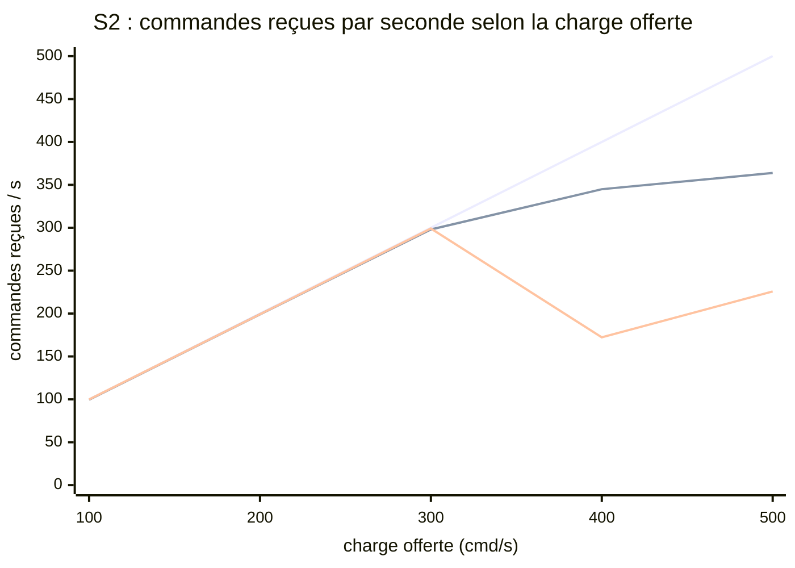
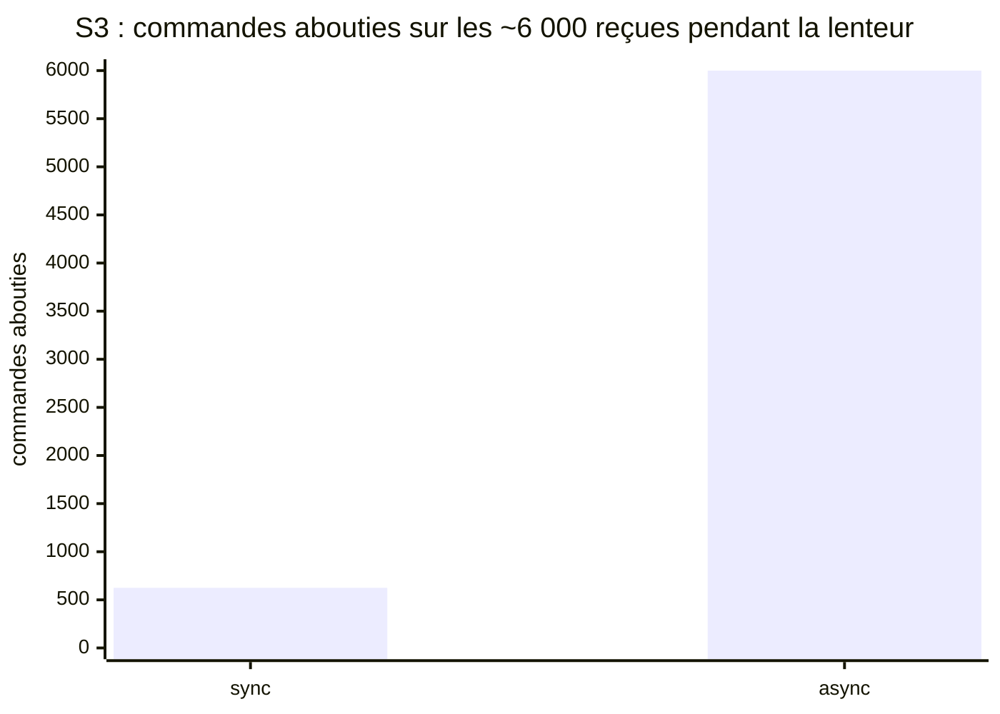
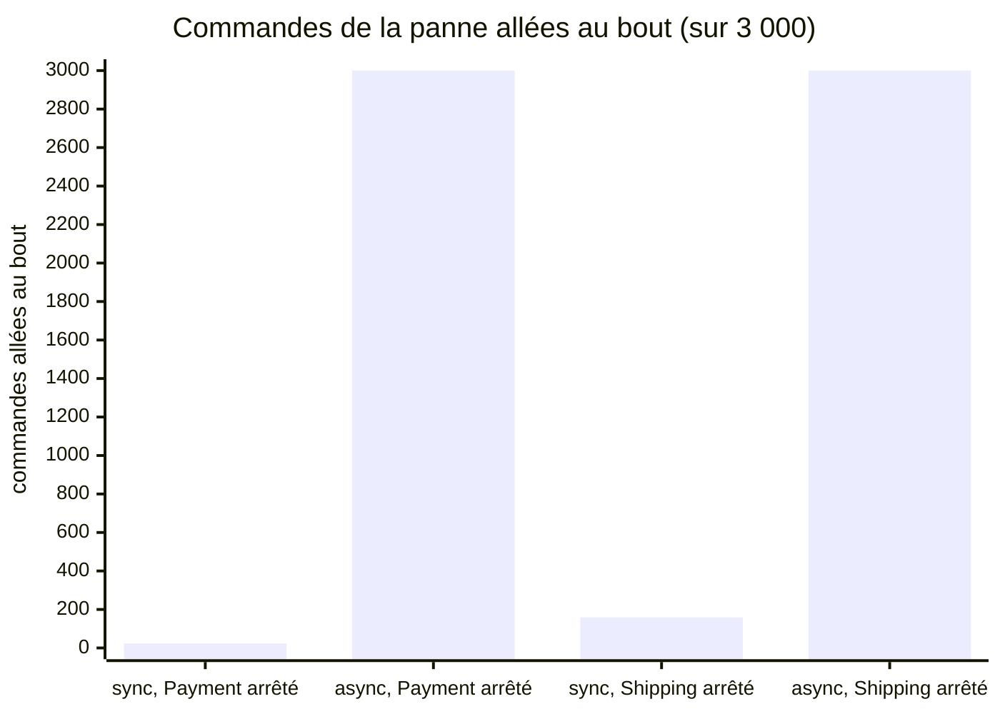
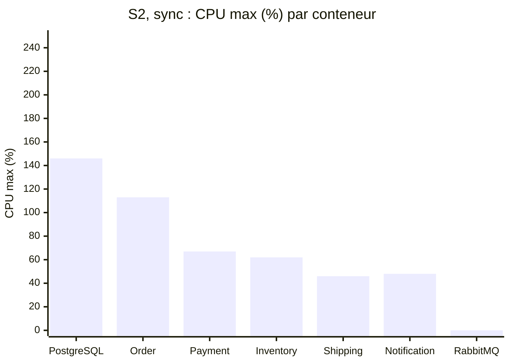
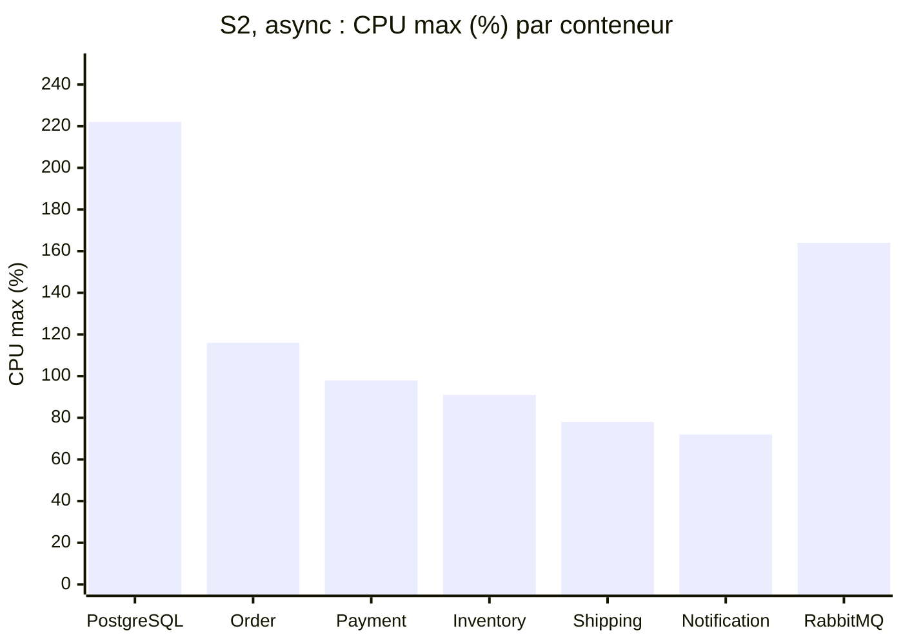
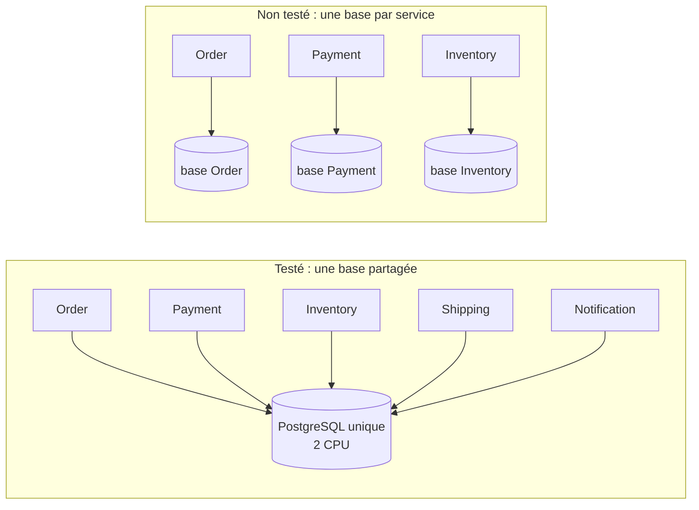
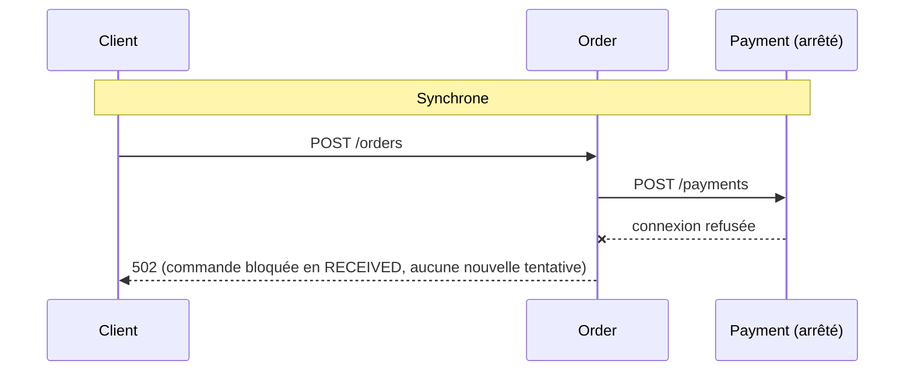
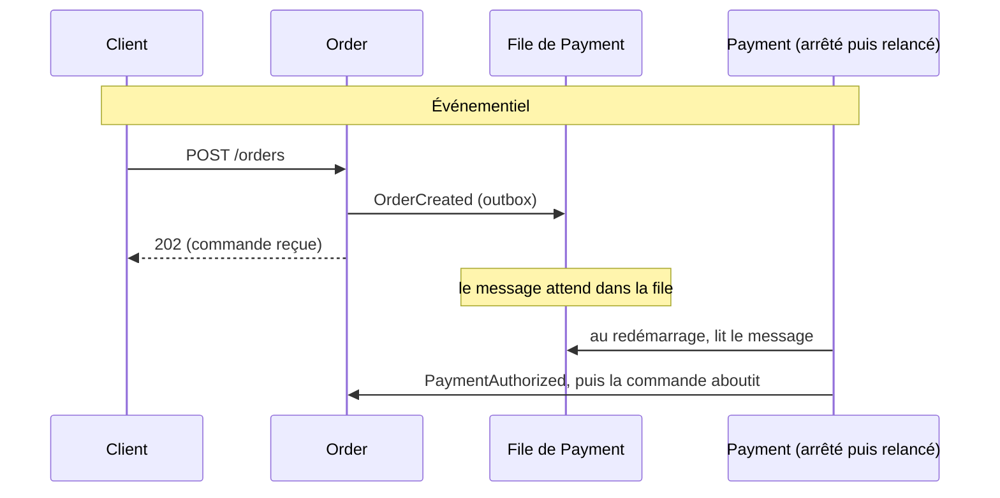

# Architecture Analysis

## 1. Ce que disent les résultats

| Question | Réponse mesurée | Verdict |
|---|---|---|
| Les deux tiennent-elles la charge normale (100 cmd/s) ? | Oui : acceptation p95 de 68 ms (sync) et 77 ms (async) | Exigence S1 respectée |
| Le sync est-il plus rapide en charge normale ? | Pas nettement : 146 contre 162 ms (−9,9 %) | H2 rejetée (provisoire) |
| L'async tient-il mieux le pic (500 cmd/s) ? | Non : aucune des deux ne tient 500 cmd/s, et le sync va plus loin (300 cmd/s contre 200) | H1 non concluante, tendance rejetée (provisoire) |
| Une panne de Shipping empêche-t-elle de terminer les commandes ? | En async non (100 % terminées) ; en sync oui (≈ 95 % jamais complétées) | H3a supportée |
| Une panne de Payment fait-elle perdre des commandes ? | Aucune perdue dans les deux ; l'async les termine toutes, le sync les laisse bloquées | H3b supportée |
| Un Payment lent fait-il attendre le client ? | En sync oui (≈ 87 % d'abandons) ; en async non (0 abandon) | H3c supportée |
| Les doublons cassent-ils l'invariant en async ? | Non avec l'idempotence, et sans surcoût visible | H4 supportée |
| Une commande est-elle plus dure à tracer en async ? | Non : 100 % de traces complètes des deux côtés | H5 rejetée |

**L'invariant (I1) n'a jamais été violé**, dans aucune variante, même en pleine saturation.

### Graphiques

Les graphiques Mermaid n'ont pas de légende : la série de chaque courbe ou barre est indiquée sous le graphique.

**G1 — Commandes entrées dans le système, par palier (S2, répétition 1)**

Courbes, de haut en bas à 500 cmd/s : charge offerte (référence), **sync**, **async**. Les deux suivent la charge jusqu'à 300 cmd/s ; au-delà, l'async décroche nettement. Attention : à 300 cmd/s, l'async reçoit encore les commandes mais les accepte plus de 6 minutes plus tard (acceptation p95 403 s, contre 619 ms en sync). Run async invalide (4,38 % d'itérations perdues), chiffres indicatifs ; run sync valide.

**G2 — Commandes allées au bout pendant que Payment répond en 2 s (S3, répétition 1)**

En sync, 87,6 % des clients abandonnent au bout de 5 s et 5 364 commandes restent bloquées. En async, aucun abandon (réponse en 3 ms) et toutes les commandes aboutissent, environ 40 s plus tard.

**G3 — Ce que deviennent les commandes reçues pendant une panne de 30 s (S4 et S4b, répétition 1)**

« Allée au bout » : commande dans un état final et, si elle est confirmée, expédiée et notifiée. En sync, sans nouvelle tentative, les commandes de la panne restent bloquées (Payment) ou confirmées sans expédition (Shipping) ; en async, elles attendent dans la file et aboutissent toutes au retour du service. Aucune commande perdue dans les quatre cas.

## 2. Interprétation

- **L'async gagne sur la résilience.** Quand une dépendance tombe ou ralentit, la file absorbe l'attente : le client reçoit sa réponse et la commande aboutit plus tard. Le sync, sans nouvelle tentative, répercute la panne au client et abandonne les commandes.
- **Le sync gagne sur la montée en charge, sur ce banc d'essai.** Son seul goulot est Order (un cœur). L'async fait beaucoup plus d'écritures par commande (outbox, idempotence, une transaction par événement) et sature la base partagée en premier.
- **En charge normale, ils se valent.** L'écart de latence est trop faible pour départager.
- **L'async coûte plus.** Plus de CPU partout (base, services, RabbitMQ), plus de mécanismes à maintenir, et une file qui fait attendre les commandes suivantes après une panne.

## 3. Matrice de décision

| Critère | Sync | Async | Preuve |
|---|---|---|---|
| Latence nominale | + | + | S1 : 68 contre 77 ms (acceptation p95) |
| Débit sous forte charge | + | − | S2 : sync conforme jusqu'à 300 cmd/s, async jusqu'à 200 |
| Tolérance aux dépendances lentes | −− | ++ | S3 : 87 % d'abandons contre 0 |
| Tolérance aux pannes | −− | ++ | S4, S4b : commandes bloquées ou incomplètes en sync, toutes terminées en async |
| Cohérence (invariant) | ++ | ++ | I1 jamais violé ; S5 : 0 doublon avec protection |
| Complexité | + | − | Async : outbox, idempotence, DLQ, balayage de secours, propagation de trace manuelle |
| Consommation de ressources | + | − | S2 : base et tous les services plus chargés en async |
| Observabilité | + | + | S1 : 100 % de traces complètes des deux côtés |
| Récupération après panne | + | − | S4 : nouvelles commandes à 58 ms (sync) contre 5,6 s (async) juste après la panne |

## 4. Compromis

| On choisit… | On gagne | On paie |
|---|---|---|
| **Sync** | Simplicité, moins de ressources, latence bornée, retour immédiat à la normale | Pannes et lenteurs répercutées au client, commandes abandonnées |
| **Async** | Pannes et lenteurs absorbées, aucune commande abandonnée | Plus de ressources, plus de mécanismes, saturation plus tôt sur une base partagée, attente après une panne |

## 5. Limites

**G4 — CPU maximal par conteneur au pic (S2, répétition 1)**

Limites : 100 % par service (1 CPU), 200 % pour PostgreSQL et RabbitMQ (2 CPU) ; au-delà, artefact d'échantillonnage (au plafond). Le sync bute sur **Order** ; l'async sature **la base partagée** et charge davantage tous les services, plus RabbitMQ (absent en sync).

**L1 — Une seule base pour les cinq services**

En async, chaque événement ajoute des écritures dans cette base commune : une ligne d'outbox puis sa marque « publiée », une ligne `processed_events` par consommateur, une transaction par événement traité (environ six événements par commande). Tout ce surcroît tombe sur **la même** base, qui sature en premier au pic. Avec une base par service, ce travail serait réparti ; le POC ne l'a pas testé. La conclusion sur la montée en charge (H1) vaut donc pour une base partagée.

**L2 — Aucune nouvelle tentative**

Règle d'équité : budget de nouvelles tentatives à 0 dans les deux variantes (aucune résilience ajoutée à une seule). En sync, rattraper ces commandes demanderait d'**ajouter** un mécanisme (nouvelle tentative, file d'attente) ; en async, la file le fait **sans mécanisme ajouté**. C'est un vrai avantage du style, mais une partie de l'écart mesuré en S3, S4 et S4b vient de cette règle : avec un même budget non nul dans les deux variantes (expérience séparée, non faite), l'écart serait réduit.

Autres limites :

- Un seul hôte (k6, services, base, broker et observabilité se partagent la machine) et un cœur par service : les conclusions valent pour **ce banc d'essai**.
- Services simulés ; Payment sans webhook.
- Orchestration (sync) contre chorégraphie (async) : deux choses changent à la fois.
- Deux répétitions seulement, et un environnement dégradé pendant la répétition 2 de S1 et S2.

## 6. Ce qui manque pour décider

1. Répétition 3 de S1 et S2 en environnement propre (H1, H2).
2. Un run S2 async exploitable : k6 sature aujourd'hui la machine avant le système.
3. Une mesure de l'hybride (H6) : c'est l'option vers laquelle pointent les résultats.

**Orientation, conditionnelle** : la résilience vient de l'async, la montée en charge et la simplicité du sync. Les résultats pointent vers une **architecture hybride** (synchrone jusqu'à la confirmation, événements pour l'expédition et la notification). La décision finale reste à prendre dans l'ADR, une fois les points ci-dessus traités.
